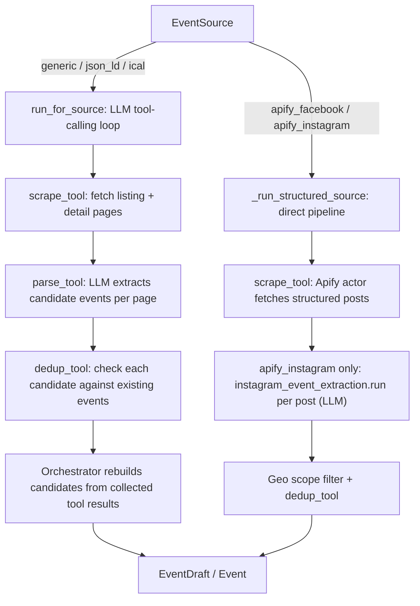

# Event Discovery Pipeline

Reference documentation for Guana Know's automated event discovery agent —
architecture, observability, and how to operate it in production. This is not
a changelog; if you're debugging a scheduled run or reading a dry-run report,
start here.

Source of truth for code: [backend/agents/orchestrator.py](../backend/agents/orchestrator.py),
[backend/guana_know/agents/models.py](../backend/guana_know/agents/models.py),
[backend/guana_know/agents/management/commands/run_discovery_agent.py](../backend/guana_know/agents/management/commands/run_discovery_agent.py).

---

## 1. Pipeline architecture

Every scheduled run processes a batch of `EventSource` rows (one URL each —
an Instagram/Facebook profile, or a generic website). Each source is handled
by one of two code paths in `orchestrator.py`, chosen by `EventSource.scrape_strategy`:



**`run_for_source` (LLM tool-calling path — `generic`, `json_ld`, `ical`):**
An Azure OpenAI model drives a scrape → parse → dedup tool-calling loop and,
at the end, is asked to emit a final JSON summary enumerating every candidate
it found. That final enumeration is **not trusted** — see §1.1.

**`_run_structured_source` (direct path — `apify_facebook`, `apify_instagram`):**
Apify returns structured post data; the orchestrator maps/dedupes it in code
without asking a model to re-enumerate the whole result set. The one exception
is `instagram_event_extraction.run()`, an LLM call made *per Instagram post*
to detect multi-event carousel posts — see §5 (Known limitations).

Both paths land on `_persist_candidates`. Candidates with any `issues` become
`EventDraft(status=pending_review)` for human review, regardless of confidence.
Issue-free candidates become `Event(source=agent)`, with `status='published'`
when `confidence >= CONFIDENCE_PUBLISH_THRESHOLD`, otherwise `status='draft'`.

### 1.1 Orchestrator vs. model responsibilities (ground-truth accumulation)

The original bug this pipeline was hardened against: the LLM's closing JSON
summary would enumerate a truncated subset of the events it actually found
(e.g. "45 found" but only 19 items listed), while still reporting a
plausible-looking `total_found`. Models reliably truncate long enumerations
even when they get the aggregate count right.

The fix: the orchestrator no longer trusts the model's final list for
anything. Instead, as each `parse_tool`/`dedup_tool` call happens during the
loop:

- `_collect_tool_result` appends every event returned by `parse_tool` to
  `collected_events`, and records each `dedup_tool` verdict by title.
- After the loop ends, `_build_candidates_from_collected` rebuilds
  `summary['candidates']` (deduped by title) directly from that ground truth,
  and `total_found` / `total_duplicates` are recomputed from it — whenever
  any events were collected, this replaces whatever the model's closing
  message said.

So: **the model orchestrates tool calls and does extraction; the orchestrator
is the sole source of truth for what was actually found.**

---

## 2. The three logging levels

| Level | Model | Granularity | Purpose |
|---|---|---|---|
| Run | `AgentRun` (Postgres) | One row per management-command invocation (a whole scheduled trigger) | Batch-level rollup: how many sources, how many events created/deduped, overall status, whether the regression guard fired anywhere in the batch |
| Step | `AgentRunStep` (Postgres) | One row per `EventSource` processed within a run | Per-source detail: status, posts scraped, drafts extracted, duplicates found, error text, timing |
| Trace | Structured JSON logs (stdout/`logs/django.log`) | One line per event (tool call, scrape, mismatch, etc.) | Fine-grained debugging — every `source.scrape_started`/`tool.parse_tool_called`/etc. event, correlated by `run_id`/`source_id` |

### 2.1 `AgentRun` fields

| Field | Meaning |
|---|---|
| `status` | `running` / `completed` / `partial_failure` / `failed` |
| `finished_at` | Set when the batch finishes |
| `sources_processed` | Sources *attempted* in this run (not necessarily succeeded — see `errors` and per-step status) |
| `events_created` | Total `Event` rows written across the batch |
| `events_deduped` | Total candidates skipped as duplicates across the batch |
| `errors` | List of `"<source_url>: <error>"` strings for sources that failed |
| `count_mismatch_detected` | `True` if **any** source in the batch tripped the regression guard (§3) |

### 2.2 `AgentRunStep` fields

| Field | Meaning |
|---|---|
| `agent_run` | FK to the parent `AgentRun` |
| `event_source` | FK to the `EventSource` this step processed (nullable — `SET_NULL` if the source is later deleted) |
| `status` | `success` / `failed` / `skipped` |
| `posts_scraped` | Number of `scrape_tool` calls (LLM path) or raw posts fetched (structured path) |
| `drafts_extracted` | `total_found` for this source |
| `duplicates_found` | `total_duplicates` for this source |
| `error` | Error text if `status == 'failed'`, else null |
| `started_at` / `finished_at` | Per-source timing |

### 2.3 Trace-level structured log events

All emitted via `_log_event(event, run_id, source_id, **fields)` in
`orchestrator.py`, rendered as single-line JSON by the `json` formatter in
`settings.LOGGING` (`pythonjsonlogger.json.JsonFormatter`). Every line carries
`run_id` and `source_id` (source_id is `null` for batch-level events like
`run.completed`).

| Event | Emitted when | Key fields |
|---|---|---|
| `source.scrape_started` | Before a source's scrape begins | `source_url`, `strategy` |
| `source.scrape_completed` | After a source's scrape+extraction finishes | `scrape_calls`/`status_code`, `total_found`, `error`, `count_mismatch_detected` |
| `tool.parse_tool_called` | Each `parse_tool` call (LLM path) | `source_url`, `events_extracted` (count only, never the full payload) |
| `tool.dedup_tool_called` | Each `dedup_tool` call | `title`, `is_duplicate` |
| `count_mismatch_detected` | The regression guard trips for a source (§3) | `reported_total`, `ground_truth_total`, `source_url`, `strategy` |
| `run.completed` | The whole batch finishes (logged by the management command) | `status`, `sources_processed`, `sources_failed`, `events_created`, `events_deduped`, `count_mismatch_detected` |

Log files: `backend/logs/django.log` (JSON, `INFO`+) and console (JSON,
`DEBUG`+) — see `LOGGING` in [backend/config/settings.py](../backend/config/settings.py).

---

## 3. The regression guard (`count_mismatch_detected`)

**Purpose:** catch recurrences of the "model under-reports its own findings"
bug class — not just the one instance that was fixed, but any future code
path with the same failure shape (a new tool added without being wired into
`_collect_tool_result`, or a different LLM call trusted to self-enumerate).

**Where it lives:** `orchestrator._detect_count_mismatch(summary, collected_events)`,
called at the end of `run_for_source` (the LLM tool-calling path) right after
candidates are rebuilt from ground truth:

```python
summary['count_mismatch_detected'] = _detect_count_mismatch(summary, collected_events)
```

It compares `summary['total_found']` (already ground-truth after the rebuild
in §1.1) against `len(collected_events)`. In normal operation these should
always be equal by construction — this check exists as a *tripwire*: if a
future change reintroduces a path where `total_found` is set from something
other than the collected ground truth, this will catch the divergence. It
returns `False` (never fires) when no events were collected at all, so a
zero-event source is never a false positive.

**What happens when it fires:**
1. A `count_mismatch_detected` structured log warning is emitted with
   `reported_total` and `ground_truth_total`.
2. The per-source result dict carries `count_mismatch_detected: true`.
3. The management command ORs this across every source in the batch and sets
   `AgentRun.count_mismatch_detected = True` on the batch record.

**Reading it in a report:** if `AgentRun.count_mismatch_detected` is `True`,
at least one source in that run had a discrepancy between what the model's
final summary reported and what was actually collected from tool calls.
Since the orchestrator *already* rebuilds candidates from ground truth
regardless, **no events are lost when this fires** — it's a signal that the
model's self-reporting is unreliable in a new way and the code path that
produced the mismatch should be investigated. Check the structured logs for
the `count_mismatch_detected` event on that run's `run_id` to find which
source and what the two numbers were.

**Scope note:** the guard only applies to `run_for_source` (the LLM
tool-calling path). `_run_structured_source` (Apify path) builds `total_found`
directly from `len(candidates)` in code and never trusts a model's
enumeration of the whole source, so the same failure mode doesn't apply
there — see §5 for the one LLM call in that path that could still have an
analogous risk.

---

## 4. Running the pipeline

### 4.1 Manually

```bash
# All active sources due for scraping (crawl_interval_hours elapsed since last_scraped_at)
python manage.py run_discovery_agent

# Dry run — full agent loop, AgentRun/AgentRunStep tracking still recorded, no DB writes of events/drafts
python manage.py run_discovery_agent --dry-run

# One specific source (bypasses the due-check), optionally dry-run
python manage.py run_discovery_agent --url "https://example.com/events" --dry-run

# Only sources using a given scrape strategy
python manage.py run_discovery_agent --strategy apify_facebook --dry-run
```

Each invocation creates exactly one `AgentRun` and one `AgentRunStep` per
source processed, dry-run or not (dry-run only skips `Event`/`EventDraft`
writes, not the observability rows). The terminal prints a `DRY RUN REPORT` /
`RUN REPORT` block per source with `Events found`, `Duplicates`, and (for
structured sources) geo-filter counts.

### 4.2 On the Azure schedule

The same management command runs unattended on a schedule (Azure scheduled
trigger). There's no interactive terminal output to read in that mode —
operate off the `AgentRun`/`AgentRunStep` Postgres rows and the structured
JSON logs instead. There are currently no alerting hooks wired to
`count_mismatch_detected` or run failures (confirmed absent as of this
writing) — a failed run or a tripped guard is only visible by querying
`AgentRun` or scanning logs, not via a push notification.

---

## 5. Known limitations / follow-ups

- **Per-post multi-event extraction is not covered by the guard.**
  `instagram_event_extraction.run(item)` (used only for `apify_instagram`
  sources) asks an LLM to detect one or more events within a single
  Instagram post (e.g. a carousel advertising several dates) and returns an
  `events` list. That list is itself a model self-reported enumeration and
  could in principle be truncated the same way the original bug truncated
  the whole-source enumeration — just at the scope of one post instead of
  one source. This has not been observed or fixed; it's flagged here as a
  follow-up investigation, not a confirmed bug.
- **No AgentRun tracking for owner-less dry runs.** `run_for_source` /
  `_run_structured_source` only create a standalone `AgentRun`/`AgentRunStep`
  when no `step` is passed in *and* `dry_run` is `False`. A caller that
  invokes the orchestrator directly with `dry_run=True` and no `step` (there
  is no such caller in the codebase today, but it's a trap for future code)
  gets zero observability rows. The scheduled management command always
  passes a `step`, so production runs are unaffected.
- **No alerting.** `count_mismatch_detected` and run failures are visible in
  Postgres/logs only. Wiring this to an actual alert (email, Slack, etc.) is
  a follow-up, not implemented here.
- Pre-existing, unrelated: three tests in `test_orchestrator_city_scope.py`
  fail on `main` due to a Unicode-normalization bug in city-name matching
  (`_is_target_city_name`/`_is_non_target_city_name` don't match names with a
  `", Mexico"` suffix). Not part of this observability work.
